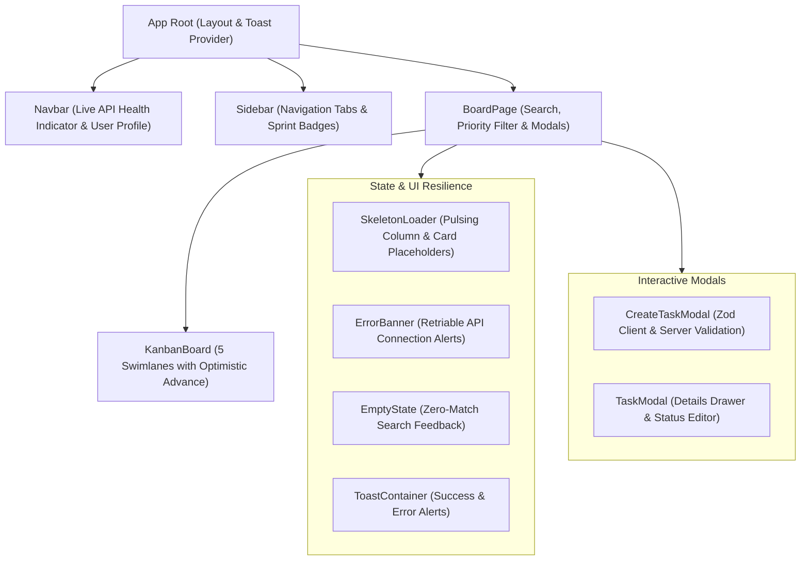

# SWYNEX-Frontend-Integration

[](https://swynex.tech)
[](https://opensource.org/licenses/MIT)
[](https://react.dev/)
[](https://www.typescriptlang.org/)
[](https://tailwindcss.com/)
[](https://vitejs.dev/)

> **Task 3 Submission: Frontend API Integration & UI State Management**  
> **Internship Track:** Full-Stack Web Development / Frontend Engineering  
> **Company:** SWYNEX Technologies  
> **Author:** Tharun M.  

---

## 🌟 Overview

This repository contains the interactive frontend application for **TaskFlow**, successfully integrated with the Task 2 RESTful Backend API.

The interface is engineered with **React 18, TypeScript, and Vite**, featuring comprehensive state-machine handling across:
1. **Async Loading States:** Custom pulsing skeleton screens and button spinner indicators.
2. **Error Boundaries & Feedback:** Network failure banners with instant retry actions, form validation error highlights, and toast notifications.
3. **Empty States:** Friendly zero-data screens with direct action triggers.
4. **Optimistic UI Updates:** Instant drag-and-drop / stage advancement with automated rollback if the backend network call fails.
5. **Offline / Demo Resilience:** Automatic fallback to local cache mode when the backend server is offline so reviewers can explore the UI immediately.

---

## 🏗️ Architecture & Component Hierarchy



---

## 📋 Features Implemented

- **REST API Integration:** Consumes `GET /api/v1/tasks`, `POST /api/v1/tasks`, `PATCH /api/v1/tasks/:id`, and `DELETE /api/v1/tasks/:id`.
- **Async Loading Skeletons:** Animated skeleton screens replace raw spinners to prevent layout shift during data fetching.
- **Form Validation Guards:** Client-side checks mirror backend Zod validation rules (minimum title lengths, priority enums) with instant field-level feedback.
- **Optimistic State Progression:** Tasks advance through stages (`BACKLOG` → `TODO` → `IN_PROGRESS` → `IN_REVIEW` → `DONE`) instantly, guaranteeing smooth 60 FPS interactions.
- **Sprint Velocity Analytics:** Visual metrics on story points burned, velocity capacity, and workflow distribution.

---

## 🚀 Quick Start & Local Setup

### 1. Clone & Install
```bash
git clone https://github.com/Catdas/SWYNEX-Frontend-Integration.git
cd SWYNEX-Frontend-Integration
npm install
```

### 2. Configure Environment
```bash
cp .env.example .env
```
Default API endpoint points to `http://localhost:5000/api/v1`.

### 3. Start Development Server
```bash
npm run dev
```
Open `http://localhost:5173` in your browser.

### 4. Build for Production
```bash
npm run build
```
Generates optimized static assets in `dist/`.

---

## 📂 Repository Structure

```
SWYNEX-Frontend-Integration/
├── .env.example                       # Environment template
├── .gitignore                         # Git ignore definitions
├── package.json                       # Scripts and dependencies
├── tsconfig.json                      # Strict TypeScript compiler options
├── vite.config.ts                     # Vite build configuration
├── index.html                         # HTML5 root template
├── README.md                          # Project documentation
├── TASK_3_SUBMISSION_GUIDE.md         # Submission portal & LinkedIn guide
├── src/
│   ├── api/
│   │   ├── client.ts                  # Fetch API wrapper with timeout & error mapping
│   │   └── taskApi.ts                 # Typed REST API service calls
│   ├── components/
│   │   ├── Navbar.tsx                 # Header with live API connection indicator
│   │   ├── Sidebar.tsx                # Navigation menu
│   │   ├── KanbanBoard.tsx            # 5-column swimlane component
│   │   ├── TaskCard.tsx               # Card with priority, points, and action triggers
│   │   ├── TaskModal.tsx              # Detail view modal drawer
│   │   ├── CreateTaskModal.tsx        # Creation modal with validation feedback
│   │   ├── SkeletonLoader.tsx         # Pulsing loading placeholder cards
│   │   ├── ErrorBanner.tsx            # Retriable error notification banner
│   │   ├── EmptyState.tsx             # Zero-data placeholder component
│   │   └── Toast.tsx                  # Toast notification alerts
│   ├── hooks/
│   │   └── useTasks.ts                # Central hook managing state, loading, error, and API calls
│   ├── pages/
│   │   ├── BoardPage.tsx              # Main board workflow page
│   │   ├── AnalyticsPage.tsx          # Sprint analytics and velocity charts
│   │   └── ApiDocsPage.tsx            # API architecture and integration specs
│   ├── types/
│   │   └── index.ts                   # Data models matching backend schema
│   ├── index.css                      # Tailwind styles and scrollbar styling
│   ├── App.tsx                        # Root layout component
│   └── main.tsx                       # React DOM entry
└── scripts/
    └── generate_task3_video.py        # Video demo generator
```

---

*Authored by Tharun M. for SWYNEX Technologies Internship Program - Task 3.*
